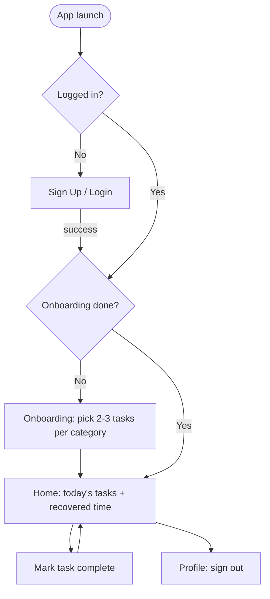
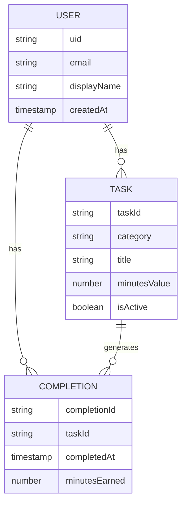
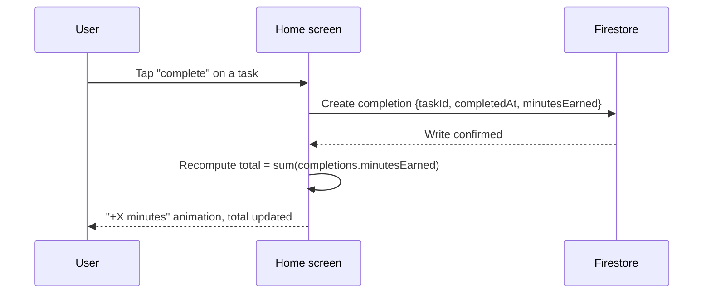

# Treasure of Time — MVP Design

Date: 2026-08-07

## Context

Treasure of Time (Tiempo Valioso) is a gamified wellness mobile app: completing small
daily obligations (health, home, work/purpose) converts them into "recovered time" the
user can spend on personally meaningful activities.

This project exists as a portfolio piece to support a Product Manager / Project Manager
job search. Prior work experience (Odaclick) is under an NDA and cannot be used as a
portfolio artifact, so this project needs to stand on its own as evidence of product
thinking and delivery.

Constraints:
- The owner is job-searching in parallel (applications, interview prep, English
  practice), so implementation time is limited. Scope and testing depth are
  deliberately minimized for the MVP.
- The owner has 3 years of prior JavaScript/TypeScript development experience and
  wants to review/co-write code, not just direct it.

## Scope

This spec covers the MVP only, corresponding to three epics already created in Jira
(project `TTA`, site `thelifeprojects.atlassian.net`):

- `TTA-6` Onboarding & Registration
- `TTA-7` Configurable Categories & Tasks
- `TTA-8` Recovered Time Engine

Out of scope for this spec (tracked as later epics `TTA-9` to `TTA-12`): Time Bank &
Personal Activities, Suggestion System, Protected Mode, Emotional Closure & Metrics.

Success criteria for the MVP: a signed-up user can select starter tasks across the
three categories, mark them complete, and see recovered time accumulate — packaged as
an installable Android APK.

## Tech Stack

- Expo (managed workflow) + TypeScript
- React Navigation (stack navigator)
- Firebase Auth (email/password) for registration/login
- Firestore for data persistence
- React Context + hooks for local app state — no Redux; app state is small enough
  that a global store would add ceremony without benefit

Rationale: the owner's TypeScript background makes React Native the fastest path to
proficiency. Firebase (BaaS) gives a real auth/data layer without the time cost of
building and hosting a custom backend, while still supporting a later upgrade to
Google Sign-In on the same Firebase Auth user base if the project grows.

## Screens

1. **Sign Up / Login** — email + password, inline validation errors (invalid email,
   weak password, wrong credentials).
2. **Onboarding** — user picks 2-3 starter tasks per category (Health, Home,
   Work/Purpose), seeded from the default task list in the SOW. Enforces the "don't
   overwhelm" MVP principle from the SOW: max 3 tasks per category at this step.
3. **Home** — today's tasks grouped by category, plus a running total: "Today you
   recovered X minutes." Marking a task complete triggers a lightweight animation and
   updates the total.
4. **Profile** — shows the logged-in email, sign-out action. No editable settings in
   this MVP.

### Screen flow



## Data Model (Firestore)

```
users/{uid}
  email: string
  displayName: string
  createdAt: timestamp

users/{uid}/tasks/{taskId}
  category: 'health' | 'home' | 'work'
  title: string
  minutesValue: number
  isActive: boolean

users/{uid}/completions/{completionId}
  taskId: string
  completedAt: timestamp
  minutesEarned: number
```

The user's total recovered time is derived by summing `completions`, not stored as a
standalone counter — avoids the counter drifting out of sync with its source data.

### Entity relationships



### Recovered time engine (core mechanic)



## Error Handling

- Auth errors (invalid email, weak password, wrong/missing credentials) are caught and
  shown inline on the Sign Up / Login screen using Firebase Auth's error codes.
- No dedicated offline-mode UI in the MVP. The Firestore JS SDK caches reads locally by
  default, which is sufficient for this stage; a full offline-first experience is
  deferred to a later epic if needed.

## Testing Strategy

Given the time constraint, testing is intentionally minimal for the MVP:
- Manual QA pass against the three in-scope epics before considering the MVP done.
- 1-2 unit tests covering the recovered-time calculation (task completion -> minutes
  added to the total), since it's the core product mechanic and the one piece of logic
  most worth protecting from regressions.
- No end-to-end or UI test automation in this phase.

This is a deliberate trade-off, not an oversight: prioritizing a working end-to-end app
over broad test coverage, given the fixed time budget. Worth calling out explicitly in
interviews as a scoping decision under constraint.

## Out of Scope / Deferred

- Google Sign-In (planned upgrade path on top of Firebase Auth, not part of MVP)
- Suggestion system, Protected Mode, Time Bank/personal activities spend flow,
  emotional closure/reflection, and metrics tracking — all deferred to epics `TTA-9`
  through `TTA-12`.
